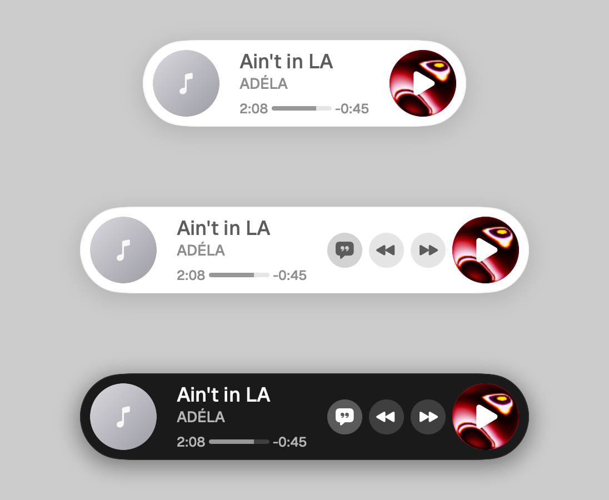

# PillMusic

Une petite pilule flottante pour piloter **Apple Musique** ou **Spotify** sur macOS : pochette animée, titre, progression, morceau précédent/suivant et paroles synchronisées — toujours à portée de main, sans ouvrir Musique.

<p align="center"></p>

## Fonctionnalités

- **Pilule flottante** qui se déplace où tu veux (y compris dans les coins), au-dessus de toutes les fenêtres, sans gêner le Dock ni voler le focus clavier.
- **Pochette en métal liquide** : un shader qui reprend les couleurs de la pochette en cours.
- **Apple Musique et Spotify** : la pilule suit automatiquement le lecteur qui joue (choix manuel au clic droit › Lecteur si les deux sont installés).
- **Contrôles** : lecture/pause, précédent, suivant, barre de progression.
- **Paroles synchronisées** (via [LRCLIB](https://lrclib.net)) qui flottent au-dessus ou en dessous de la pilule ; glisser pour relire les lignes précédentes.
- **Raccourci global** `⌃⌘M` pour afficher/masquer la pilule.
- **Thème clair / sombre**, trois tailles, lancement à l'ouverture de session.
- **Économe** : moins d'images par seconde sur batterie et en mode économie d'énergie, rendu en pause quand la pilule est cachée.

## Installation

Télécharge `PillMusic.zip` depuis les [Releases](../../releases), dézippe et glisse **PillMusic.app** dans **Applications**.

L'app n'est pas notariée par Apple : au premier lancement, fais **clic droit → Ouvrir** (ou *Réglages Système → Confidentialité et sécurité → Ouvrir quand même*). macOS demandera ensuite l'autorisation de contrôler **Musique** ou **Spotify** : accepte-la. Pour Spotify, il faut l'app de bureau (pas la version web).

Nécessite macOS 14 (Sonoma) ou plus récent.

## Compiler soi-même

Pas besoin de Xcode, les outils en ligne de commande suffisent (`xcode-select --install`).

```sh
./scripts/build.sh      # → build/PillMusic.app
./scripts/package.sh    # → build/PillMusic.zip, prêt à partager
```

## Structure

| Fichier | Rôle |
| --- | --- |
| `Sources/PillMusic/App.swift` | Fenêtres, menu, raccourci, placement à l'écran |
| `Sources/PillMusic/PillView.swift` | Interface de la pilule (SwiftUI) |
| `Sources/PillMusic/MusicController.swift` | Dialogue avec Musique et Spotify (AppleScript) |
| `Sources/PillMusic/LiquidMetal.swift` | Shader de la pochette |
| `Sources/PillMusic/Lyrics.swift` | Paroles synchronisées |
| `Sources/PillMusic/Artwork.swift` | Recherche de pochettes et de liens |
| `Sources/PillMusic/Power.swift` | Adaptation à la batterie |
| `icon/` | Génération de l'icône de l'app |

## Crédits

- Police [Geist](https://vercel.com/font) — SIL Open Font License (`Resources/Geist-OFL.txt`).
- Paroles fournies par [LRCLIB](https://lrclib.net).

## Licence

[MIT](LICENSE)
